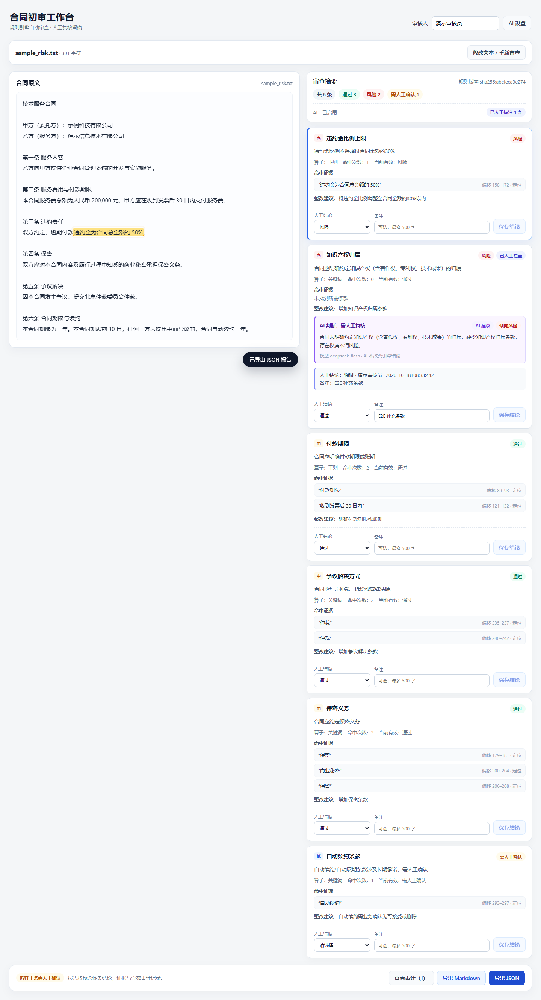

# 合同初审工作台

规则驱动的合同初审工具：上传或粘贴合同 → YAML 规则审查 → 证据定位 → 人工复核留痕 → 导出报告。



## 功能

- 6 条 YAML 规则，覆盖关键词与正则；新增规则只改 `backend/rules/review_rules.yaml`，重新审查即生效（支持热重载）。
- 证据使用 Unicode 码点偏移，原文高亮，点击证据可定位并闪烁强调。
- 每条规则可人工改判为「通过 / 风险 / 不适用」，服务端写入 JSONL 审计：谁、何时、原值、新值、备注。
- 报告导出 Markdown / JSON，包含摘要、逐条结论、证据、完整审计与免责声明。
- LLM 兜底（可选）：仅对未命中的规则调用，标注「AI 判断，需人工复核」，不改变引擎结论；无 Key 时前端本地模拟并明确说明，模拟结果不进入审计或报告。

## 快速开始（Docker）

```bash
cp .env.example .env    # 可选：填写 AI Key；留空则使用前端模拟（Windows: copy .env.example .env）
docker compose up --build
```

访问 <http://localhost:8000>。默认端口被占用时可换端口：

```bash
APP_PORT=18000 docker compose up --build
# PowerShell: $env:APP_PORT=18000; docker compose up --build
```

- 规则与样例以只读方式挂载，修改 `backend/rules/review_rules.yaml` 后重新审查即生效。
- 审查与审计数据保存在命名卷 `contract-review-data`；`docker compose down -v` 可清空。
- 需要 Docker Compose v2.24+（使用 `env_file.required`）。
- 若无法直连 Docker Hub，可先通过可用的镜像加速器拉取 `node:24-alpine` 与 `python:3.12-slim`，再 `docker tag` 为原始名称后构建。

## 本地开发

后端：

```bash
cd backend
python -m venv .venv
.venv\Scripts\activate          # macOS/Linux: source .venv/bin/activate
pip install -r requirements.txt
uvicorn app.main:app --reload --port 8000
```

前端：

```bash
cd frontend
npm install
npm run dev
```

访问 <http://localhost:5173>；Vite 会把 `/review`、`/report` 等路径代理到 8000。

## 使用流程

1. 选择内置样例，或上传 `.txt` / `.md`、直接粘贴文本。
2. 点击「开始审查」。
3. 点击证据条目，在左侧原文中定位并高亮。
4. 为每条规则填写人工结论与备注并保存；「查看审计」可查看完整留痕。
5. 导出 Markdown 或 JSON 报告。

样例预期：全通过样例 → 6 通过；风险样例 → 3 通过 / 2 风险 / 1 需人工确认。

## AI 配置（可选）

- 无 Key：启用 AI 时前端用本地同义词启发式模拟，页面顶部横幅说明；模拟结果不写审计、不进报告。
- 服务端（推荐）：在 `.env` 中填 `ANTHROPIC_API_KEY`；兼容 Anthropic 协议的服务端可改用 `ANTHROPIC_AUTH_TOKEN` + `ANTHROPIC_BASE_URL`，并用 `ANTHROPIC_MODEL` 指定模型。
- 界面：右上角「AI 设置」可临时输入 Key（仅 `sessionStorage`）与模型。
- 优先级：请求头 Key → 服务端 API Key → 服务端 Auth Token。
- 公网部署不要在前端输入真实 Key，应使用服务端环境变量并启用 HTTPS。

## 规则扩展

在 `backend/rules/review_rules.yaml` 中增加规则块：`id`、`name`、`severity`、`expect`、`operator`，以及 `keywords` 或 `pattern`。保存后重新审查即可生效，无需改代码或重启服务（热重载）。

## 数据与隐私

审查快照与 JSONL 审计仅保存在本地 `data/`（Docker 中为命名卷）；`.env` 与 `data/` 已在 `.gitignore` 中排除。合同文本只有在启用 AI 且配置 Key 时才会发送给模型服务。

## 测试

```bash
cd backend
.venv/Scripts/python.exe -m pytest -q        # 66 tests

cd frontend
npm test                                      # 12 Vitest
npm run lint
npm run build
npm run test:e2e                              # 需后端 8000 与本机 Edge
```

E2E 支持 `FRONTEND_URL` 指向其他端口；后端无 Key 时会额外验证模拟横幅、模拟 AI 标注与导出提示。

## API 示例

```bash
curl -X POST http://localhost:8000/review \
  -H "Content-Type: application/json" \
  -d '{"text":"双方约定，逾期付款违约金为合同总金额的50%。","filename":"demo.txt"}'

curl -X POST http://localhost:8000/report \
  -H "Content-Type: application/json" \
  -d '{"review_id":"<review_id>","format":"markdown"}'
```

## 目录结构

```
backend/            FastAPI、规则引擎、存储与测试
frontend/           React + TypeScript 单页
docs/DESIGN.md      设计决策、实现记录与测试流程
Dockerfile          多阶段构建（前端构建 + 后端运行时）
docker-compose.yml  单容器部署
AI 使用说明.md      AI 协作过程与人工修改记录
```

## 已知限制

仅支持纯文本；无登录与权限体系（审核人由用户填写）；正则对数值阈值的判断有限；单 worker 运行；报告为工具辅助结果，不构成法律意见。

更多设计与验证细节见 [docs/DESIGN.md](docs/DESIGN.md)，AI 协作记录见 [AI 使用说明.md](AI%20使用说明.md)。
